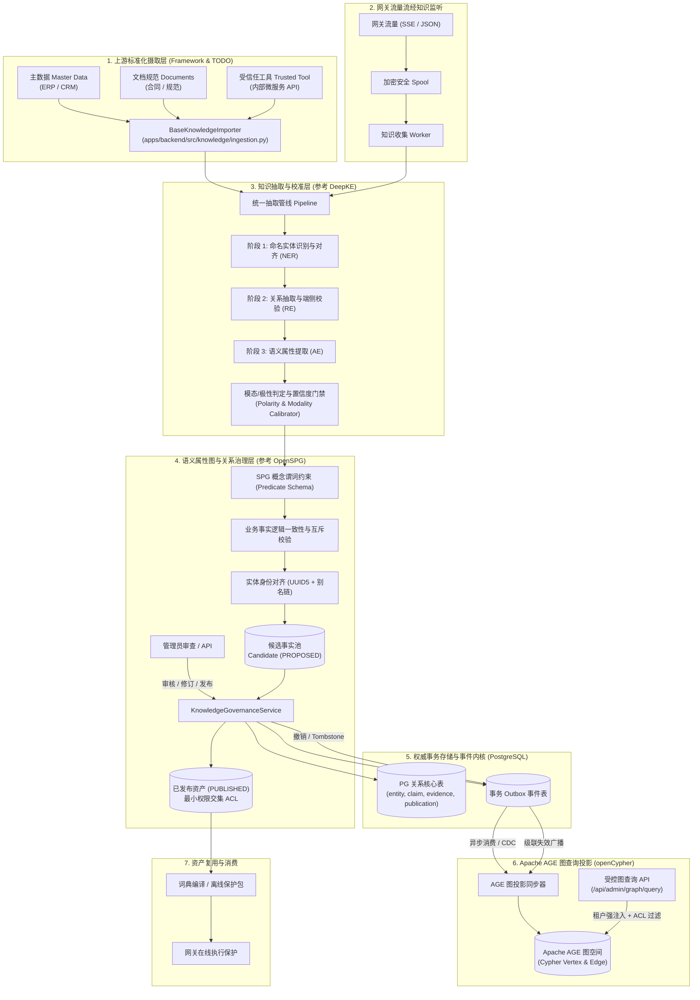

# 企业隐私网关知识图谱架构设计规范

本文档定义企业隐私网关知识图谱体系的整体架构设计、治理逻辑、抽取增强、图查询集成及演进规范。

---

## 1. 架构背景与核心设计原则

企业隐私网关不仅承担大模型交互中的在线脱敏与重组，同时需要对流经网关的企业敏感关系知识进行沉淀、抽取、治理与资产复用。传统知识图谱方案在企业隐私网关场景下存在三大痛点：
1. **外部知识摄取混乱**：企业主数据、非结构化文档与外部工具数据缺乏统一的信度定义、身份对齐与准入校验；
2. **流经事实缺乏治理与自证风险**：大模型生成内容（`MODEL_OUTPUT`）与单纯上下文共现容易被误当做确定性企业事实入库，产生幻觉扩散；
3. **图查询与多租户权限割裂**：传统独立图数据库（如 Neo4j、Nebula）无法复用 PostgreSQL 成熟的行级安全（RLS）、会话审计与严苛事务事务保障。

为此，本方案遵循以下**核心设计原则**：

* **PostgreSQL 为单一治理事实源（Source of Truth）**：所有实体、主张（Claim）、证据、候选、发布、操作审计及 Outbox 事务日志权威持久化于 PostgreSQL 关系表中。
* **Apache AGE 为内置只读图投影（Graph Query Projection）**：引入 PostgreSQL 原生图扩展 **Apache AGE**，以 openCypher 提供多跳图分析能力；图后端作为可重建的查询投影，坚决不承担核心事务与写入权限控制。
* **零模型自证与证据强绑定（Evidence-Governed）**：遵循 [ADR 0002](adr/0002-evidence-governed-knowledge.md)，流经网关的数据必须记录精确字符坐标（Span）、SHA-256 摘要、语气模态（Modality）与正负极性（Polarity）。模型生成内容与文本共现绝不自证业务事实。
* **借鉴 OpenSPG 与 DeepKE 的深度治理**：
  * 参考 **OpenSPG**（语义属性图，Semantic Property Graph）：建立概念谓词约束（Schema Constraints）、实体唯一性对齐（Entity Resolution）与逻辑互斥规则校验；
  * 参考 **DeepKE**：建立解耦的多阶信息抽取管线（NER -> RE -> AE），融合规则与本地轻量级模型，量化置信度与细粒度证据锚定。
* **上游标准化摄取渐进式落地**：上游标准化摄取先行定义通用框架、校验契约与接口抽象，具体连接器通过 TODO 分步实现，避免大包推进。

---

## 2. 总体架构全景



---

## 3. 上游标准化摄取设计（Framework & TODO）

### 3.1 核心数据结构与契约
上游摄取框架代码位于 [`apps/backend/src/knowledge/ingestion.py`](../apps/backend/src/knowledge/ingestion.py)，核心对象定义如下：

* **`IngestionSourceMeta`**：声明批次来源元数据，包括 `tenant_id`、`domain`、`source_kind`（`MASTER_DATA` / `DOCUMENT` / `TRUSTED_TOOL`）、`version`、`acl`、`observed_at` 和 `retention_until`。
* **`RawEntityItem`**：上游标准化实体输入，包含名称 `name`、实体类别 `entity_type`、外部主键 `external_id`、别名列表 `aliases`、属性字典 `properties` 及置信度 `confidence`。
* **`RawRelationItem`**：上游标准化关系输入，包含主客体标识 `subject_name_or_id` / `object_name_or_id`、谓词 `predicate`、极性 `polarity`、模态 `modality`、属性字典 `properties` 及证据跨度 `evidence_span`。
* **`IngestionBatch`**：批次容器，封装元数据、实体集合与关系集合。
* **`IngestionValidationReport`**：结构化校验报告，枚举严重等级（`ERROR` / `WARNING`）及字段路径。

### 3.2 抽象基类与连接器规划
* **`BaseKnowledgeImporter(ABC)`**：
  * `validate_batch(batch)`：执行数据结构、必填项与约束校验。
  * `normalize_batch(batch)`：执行标准化归一化，派生 UUID5 唯一标识，绑定别名。
  * `ingest(batch)`：持久化事务写入管线（当前定义契约并抛出 `NotImplementedError`，保留 TODO 规范）。
* **专用连接器存根（Stubs）**：
  * **`MasterDataImporter`**：ERP/CRM/MDM 批量字典连接器（要求置信度最高，必须声明实体外部主键）。
  * **`DocumentKnowledgeImporter`**：非结构化文档导入连接器（强制校验字符级证据文本与起止区间）。
  * **`TrustedToolImporter`**：内部微服务工具调用结果摄取连接器。

---

## 4. 基于 DeepKE 的网关流经知识抽取与校准增强

针对网关在实时转发与异步 Spool 中截获的非结构化交互文本，参考 **DeepKE** 的多阶抽取架构，解耦并升级原先单一的 [`extractor.py`](../apps/backend/src/knowledge/extractor.py)：

### 4.1 多阶抽取管线（Multi-Stage Pipeline）
1. **Stage 1: 命名实体识别与实体链接（NER & Entity Linking）**
   * 复用网关内置的轻量化 ONNX 模型（如 `bert4ner-base-chinese-onnx`）与企业确定性词典，识别文本中的机构（`ORG`）、人员（`PERSON`）、产品（`PRODUCT`）等基础实体；
   * 对抽取到的实体名称进行别名归一化（如“甲公司”与“甲科技有限责任公司”链接至同一权威实体）。
2. **Stage 2: 关系抽取与端侧校验（Relation Extraction - RE）**
   * **双轨校验机制**：采用“业务规则语法模板”与“本地离线轻量分类模型”双轨机制；
   * 优先匹配高精度的语法规则（如正向采购 `_SUPPLIES_POSITIVE`、反向供货等）；
   * 规则未命中或存在歧义时，由本地离线轻量模型评分，输出候选关系及置信度得分（`0.0 ~ 1.0`）；严禁将数据外发至公网第三方模型判定。
3. **Stage 3: 语义属性抽取（Attribute Extraction - AE）**
   * 抽取附着于关系上的属性（如交易金额、产品型号、生效时间、交付地点），形成富属性边（Edge Attributes）。

### 4.2 模态（Modality）与极性（Polarity）校准
* **否定极性检测（Negative Polarity）**：
  * 精确识别否定副词（`未`、`没有`、`并未`、`不曾`）以及辟谣/更正语境（`说法不实`、`并非事实`），生成 `Polarity.NEGATIVE` 关系，避免将负向声明反转为正向事实。
* **模态分级（Modality Detection）**：
  * **`ASSERTED`**：陈述性客观事实（如“甲公司向乙公司采购了五台设备”）；
  * **`HYPOTHETICAL`**：规划、假设、条件或未生效意图（包含`计划`、`如果`、`预计`、`准备`等）；
  * **`QUESTION`**：提问或咨询（包含`？`、`是否`、`请问`等），只记录为待核实线索，不可作为业务凭据。
* **模型输出信任降级（No Self-Certification）**：
  * 若文本来源为 `SourceKind.MODEL_OUTPUT`，即便语法为肯定断言，其模态**强制降级为 `Modality.HYPOTHETICAL`**，杜绝大模型“一本正经胡说八道”污染知识库。

### 4.3 字符级精细证据锚定
每条抽取出来的关系必须携带 `Evidence` 实例：
* 文本 SHA-256 完整摘要；
* 文本中的闭开区间 `[start, end)`；
* 严格禁止无证据支持的三元组入库。

---

## 5. 基于 OpenSPG 的语义属性图与关系治理设计

参考 **OpenSPG**（语义属性图）对知识图谱 Schema 与规则逻辑的治理框架，对网关流经知识实施结构化约束：

### 5.1 SPG 概念谓词约束（Predicate Schema）
建立谓词白名单与 Domain/Range 类型强校验：
* **模式定义（Schema Specification）**：
  ```text
  Predicate: supplies
    Domain: ORG
    Range: ORG
    Attributes: [contract_id: string, amount: float, effective_year: int]
    InvertedPredicate: supplied_by

  Predicate: works_on
    Domain: PERSON
    Range: PROJECT | PRODUCT
    Attributes: [role: string, since: date]
  ```
* **类型守卫（Schema Guard）**：
  * 当抽取系统试图创建 `PERSON supplies ORG` 等不符合域定义的三元组时，Schema 守卫直接将其标记为非法并阻断，防止实体类型错误传播。

### 5.2 实体对齐与唯一身份派生（Entity Resolution & UUID5）
* 严禁直接使用实体文本名称作为底层主键；
* 权威主键采用 UUID5 确定性命名空间算法生成：
  $$\text{Entity UUID} = \text{UUID5}(\text{NAMESPACE\_DNS}, \text{tenant\_id} + ":" + \text{domain} + ":" + \text{entity\_type} + ":" + \text{canonical\_name})$$
* 建立 `entity_aliases` 别名表，记录别名到权威 UUID5 的映射链，支持别名合并与历史重命名追踪。

### 5.3 业务事实一致性与互斥规则校验（Consistency & Mutual Exclusion）
* **正负互斥检测**：同一主体与客体在相同时间窗口内，若同时存在 `POSITIVE supplies` 与 `NEGATIVE supplies`，规则引擎将其标记为 `DISPUTED`（争议事实），阻断自动发布，挂起至管理端待人工裁决；
* **共现隔离原则（Co-occurrence Isolation）**：多个实体在同一段落共现但无明确动词语法连结的，严格降级为 `Predicate.CO_OCCURS_WITH`，绝不自动晋升为采购或所属权关系。

### 5.4 最小权限交集与级联失效（ACL Intersection & Invalidation）
* **多证据合并**：一个候选事实可以关联多个来源的 Evidence；
* **发布权限交集**：已发布事实的可见受众（Audience）、允许用途（Purpose）和有效期（Valid Until）强制取**所有支持来源治理属性的最小交集**：
  $$\text{Publication ACL} = \bigcap_{s \in \text{Sources}} \text{ACL}(s)$$
* **级联失效（Cascading Tombstone）**：若上游某一关键凭证被调用 `withdraw_source` 撤回，系统自动级联失效依赖该凭证的所有发布项，生成 Tombstone 并广播至下游消费端与图投影。

---

## 6. 基于 Apache AGE 的图查询能力设计

### 6.1 技术选型：为何引入 Apache AGE？
企业隐私网关目前采用本机已有 PostgreSQL 5433。若引入独立图数据库（如 Neo4j、Nebula），将引入高昂的跨网络同步、运维负担及分布式一致性隐患。
**Apache AGE** 是 PostgreSQL 的官方扩展（Extension），支持在 PostgreSQL 关系库内使用标准 **openCypher** 查询语言，具备以下显著优势：
1. **同库同机部署**：作为 PG Extension 直接装载于 5433 实例，与现有的 `enterprise_gateway` 关系库共享存储、事务、备份与连接池；
2. **读写分离与架构解耦**：PostgreSQL 关系表继续作为唯一的 ACID 治理与安全权威，AGE 图空间仅作为**只读查询投影（Query Projection）**；
3. **零 RLS 污染**：避免将复杂的图多跳查询直接穿透到底层多租户行级安全（RLS）表，防止权限漂移。

### 6.2 AGE 图投影数据模型
在 PostgreSQL 内部通过 AGE 创建图空间，默认名字为 `kg_projection_<namespace-hash>`：数据库及关系表 namespace 决定稳定后缀，同一数据库的不同事实源 namespace 独立投影与重建。
* **顶点标签（Vertex Label: `Entity`）**：
  * `id`: 实体稳定 UUID（字符串）；
  * `tenant_id`: 租户隔离标识；
  * `domain`: 业务域；
  * `type`: 实体类别（如 `ORG`, `PERSON`）；
  * `name`: 规范化显示名称；
  * `aliases`: 别名数组；
* **边标签（Edge Label: `Claim`）**：
  * `claim_id`: 边主键 UUID；
  * `predicate`: 谓词名称（如 `supplies`, `works_on`）；
  * `polarity`: 极性（`positive` / `negative`）；
  * `modality`: 模态（`asserted` / `hypothetical`）；
  * `publication_id`: 对应的已发布资产标识；
  * `valid_until`: 有效期时间戳；
  * `is_active`: 布尔值（是否仍处于有效治理状态）；
  * `properties`: JSONB 富属性字典。

### 6.3 增量投影与生命周期联动
图投影的同步由后台 Worker 消费事务 Outbox 事件驱动，实现异步更新：
1. **发布同步**：
   * Worker 监听到 `publication_published` 事件；
   * 执行 openCypher 命令在 AGE 中 `MERGE` 顶点并 `CREATE/MERGE` 关系边：
     ```cypher
     MERGE (s:Entity {id: $subject_id})
     ON CREATE SET s.name = $subject_name, s.type = $subject_type, s.tenant_id = $tenant_id
     MERGE (o:Entity {id: $object_id})
     ON CREATE SET o.name = $object_name, o.type = $object_type, o.tenant_id = $tenant_id
     CREATE (s)-[r:Claim {
       claim_id: $claim_id,
       predicate: $predicate,
       polarity: $polarity,
       modality: $modality,
       publication_id: $pub_id,
       valid_until: $valid_until,
       is_active: true
     }]->(o)
     ```
2. **撤销与到期同步（Tombstone Propagation）**：
   * Worker 监听到 `publication_withdrawn` 或 `source_withdrawn` 事件；
   * 执行 Cypher 软删除或物理清理：
     ```cypher
     MATCH ()-[r:Claim {publication_id: $pub_id}]->()
     SET r.is_active = false
     ```
3. **全量一致性重建**：
   * AGE 图空间定义为“可丢弃、可完全按 PostgreSQL 关系表重放”的派生产物。系统提供一键重建脚本，从 `publication` 与 `claim` 关系表清空并重新初始化图空间。

### 6.4 受控图查询服务（Governed openCypher Interface）
外部应用或管理端**绝不直接裸连数据库执行任意 Cypher**，必须通过受控的图查询服务接口（`GovernedGraphQueryService`）：
* **强制参数化租户隔离**：租户与业务域绑定由认证装配提供，不能由请求参数覆盖；
* **受控语法解析与改写**：
  * 仅接受带 `Entity` / `Claim` 标签、最多四跳的固定长度 `MATCH` 模式、简单属性比较、`RETURN` / `count` 与有界 `LIMIT`；完整语法边界见[管理端契约](contracts/admin-console.md#受控图查询)。
  * 服务端为每个节点和边追加 `tenant_id` 与 `domain` 条件，为每条边追加 `is_active = true` 和 `valid_until_epoch > $_now_epoch` 条件；聚合与返回列在过滤后求值。
  * 数据库事务只读；拒绝未支持的语法，禁止用 `UNION`、子查询或任意函数绕开边界。
  * 阻断任意可能破坏图完整性或读取跨租户数据的危险查询。
* **审计日志留痕**：每次图遍历的调用方标识、查询语法摘要、耗时及命中节点计数均记入安全审计流。

---

## 7. 契约定义与管理 API 规范

### 7.1 新增管理接口清单
| 接口路径 | HTTP 方法 | 功能描述 | 权限与安全门禁 |
| :--- | :--- | :--- | :--- |
| `/api/admin/knowledge/ingest` | `POST` | 提交上游标准化知识批次（框架预留） | 管理员会话、CSRF 校验、来源合规校验 |
| `/api/admin/knowledge/ingest/validate` | `POST` | 预校验上游批次格式与谓词约束 | 管理员会话、CSRF 校验 |
| `/api/admin/graph/query` | `POST` | 执行受控 openCypher 图查询 | 管理员会话、CSRF、AST 租户强制改写 |
| `/api/admin/graph/rebuild` | `POST` | 触发从 PG 事实源向 AGE 全量重投影 | 最高安全角色、幂等任务执行器 |

### 7.2 图查询请求与响应契约示例
* **请求体（`GraphQueryRequest`）**：
  ```json
  {
    "cypher": "MATCH (s:Entity)-[r:Claim {predicate: 'supplies'}]->(o:Entity) RETURN s.name, r.polarity, o.name LIMIT 50",
    "params": {},
    "purpose": "supply_chain_audit"
  }
  ```
* **响应体（`GraphQueryResponse`）**：
  ```json
  {
    "nodes": [
      {"id": "c1f7b8...", "name": "乙公司", "type": "ORG"},
      {"id": "a9b2e1...", "name": "甲公司", "type": "ORG"}
    ],
    "edges": [
      {
        "claim_id": "893df1...",
        "source": "c1f7b8...",
        "target": "a9b2e1...",
        "predicate": "supplies",
        "polarity": "positive",
        "modality": "asserted"
      }
    ],
    "execution_time_ms": 12.4
  }
  ```

---

## 8. 实施路径与演进路线图

知识图谱建设按以下 5 个递进阶段推进：

### 8.1 阶段 1：上游标准化摄取框架与契约基石
* 定义上游摄取规范模型：`IngestionSourceMeta`, `RawEntityItem`, `RawRelationItem`, `IngestionBatch`；
* 实现抽象基类 `BaseKnowledgeImporter`、专用导入器存根及 TODO 注解；
* 提供单元测试与契约自洽性校验；
* 确立技术设计规范文档。

### 8.2 阶段 2：基于 DeepKE 的流经关系抽取与校准增强
* 扩展 `extractor.py` 为多阶段抽取管线：解耦实体对齐、关系抽取与属性抽取；
* 增加否定词（Polarity）与假设疑问词（Modality）细粒度检测算法；
* 接入本地离线轻量 ONNX 分类模型作为双轨校验，增加置信度阈值门禁。

### 8.3 阶段 3：基于 OpenSPG 的语义属性图约束与规则引擎
* 定义 `PredicateSchema` 强类型约束机制（Domain / Range 校验）；
* 实现业务逻辑互斥事实校验器（正负关系互斥、时间窗口冲突、争议事实挂起）；
* 实体别名链管理与 UUID5 确定性对齐持久化。

### 8.4 阶段 4：PostgreSQL + Apache AGE 图扩展装配与 Outbox 投影
* 在本地开发环境及 Compose PostgreSQL 5433 环境装载 `apache-age` 扩展；
* 编写 Outbox 图同步器 Worker，将 `PUBLISHED` / `WITHDRAWN` 事实单向投影至 AGE；
* 实现全量从关系表重建 AGE 图空间的自动化运维作业。

### 8.5 阶段 5：受控 Cypher 查询 API 与管理端图谱可视化
* 实现 `/api/admin/graph/query` 及 AST 租户条件强制注入；
* 在 React 管理端集成图拓扑可视化组件（展示实体关系图谱、证据详情卡片及谱系回溯）；
* 完成端到端 E2E 浏览器与集成测试验证。
